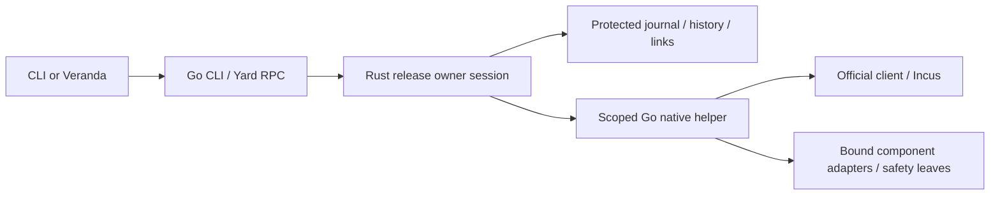

# Rust release-transition owner

This ADR selects a complete Rust release-transition owner as the next architecture to evaluate.
It specifies the ownership and protocol contracts for that evaluation. Production still uses the
Go owner described in [Architecture](control-plane-architecture.md) and
[Release transitions](resumable-release-transition-design.md). This decision does not establish
runtime equivalence, production performance, production codecs or permission to switch writers.

## Context and alternatives

The current shared prepared-command pipeline does not make config apply, config sync, project
admission and release update one transaction. Release alone already binds a complete durable
transition to an exact retained executable. That is a useful bounded ownership unit for Rust.
Moving a planner alone leaves authorization, effects and recovery in another language/process.

| Boundary | Process and authority | Delivery and Go changes | Benefit, cost and disposition |
| --- | --- | --- | --- |
| A: pure history/policy | Go remains release owner; Rust supplies checked semantic values through FFI or a child | Adds Rust artifact/codec or native ABI; Go orchestration and persistence remain | Useful comparison against strengthened Go; limited local guarantees and potential duplicate policy. Keep as a non-production experiment on the same history corpus |
| B: complete release owner | One Rust operation session owns plan, authorization admission, locks, journal, effects ordering and recovery; bounded Go adapters execute component operations | Adds a verified Rust owner and scoped native helper; removes the active Go release reducer after cutover, with historical exact owners retained | Chosen for evaluation: covers a complete safety chain, with substantial adapter extraction, recovery and delivery work |
| C: Rust owner control plane | Rust also owns shared CLI/RPC operation preparation and other operation families | Broad application/API transfer; Go native adapters and old-owner routing still needed | Possible later direction; config/resource/project contracts have separate owners and cannot be proven by release work. Defer until B demonstrates value |
| D: independent components | Each Rust component owns its own bounded scope; release remains Go | Small local changes and independent artifacts, but more boundaries if components are interdependent | Appropriate for independently useful components; does not demonstrate complete release ownership |

Strengthened Go is the comparison baseline. Existing private fields, checked constructors and deep
copies already provide useful guarantees. Rust adds closed payload variants, exhaustive matching,
immutable ownership and consuming phase handles only where the actual API uses them. No production latency,
startup, CPU, RSS or test-count improvement has been established for these alternatives.

The source baseline now includes the shared Go prepared lifecycle, sealed approval snapshot,
serialized confirmation/execution/close and consumption before native admission
([prepared_command.go](../../internal/cli/prepared_command.go)). Mutable preview `Confirmed` does
not confer authority, and copied handles share one runtime consumption guard. The Rust comparison
must demonstrate additional compiler-enforced properties against this baseline and the final
single history model, rather than reproduce a previously fixed Go approval weakness.

A adds cross-language semantic/codec or ABI checks; B also adds child lifecycle, cancellation,
unknown-effect and retained-owner compatibility checks. C extends that surface to every migrated
command/RPC family; D needs only its owning component's checks and cannot replace release tests.
B introduces process startup, concurrent runtime memory and DTO serialization/copying, with bulk
streams handled separately. Debugging must correlate bounded owner/operation/step/request IDs and
native operation outcomes across processes without logging authorization or raw payloads. These
are structural costs, not measured regressions or an argument that Rust necessarily saves memory.

## Decision and process topology

Evaluate B with Rust-native release semantics and protected POSIX storage, and retain the official
Incus Go client behind an operation-scoped stdio helper. Keep CLI/RPC presentation in Go initially.
The helper lasts for one transition session; it is neither a shared daemon nor a public endpoint.
One session retains the Rust prepared value from inspection through confirmation and execution.

Rust owns the release assessment, allowed history/trace, approved scope, authorization admission,
transition order, journal/evidence, checkpoint/projection policy, replacement eligibility,
retirement decisions and aggregate Ready outcome. It uses the final single migration-history
model; the experiment must not introduce a second production admissible-history set.

Go presentation renders the owner's assessment and confirmation policy and returns the user's
answer over the retained private session. It does not select a migration, authorize broader work
or manufacture a Rust executable capability from public JSON. Existing automation confirmation
still answers only the prompt; fresh guards remain mandatory.

Component owners retain their declared semantic validation and physical mechanics. Their recipes,
desired state, source bindings, consequences and permissible conditional work must be captured in
the release plan before consent. Native execution can reject changed facts or prove convergence;
it cannot choose a wider release operation or introduce new adoption permission. Profile behavior
remains in the owning profile. This is subordinate component ownership, not a claim that every
component consists only of policy-free system calls.

Current ports are not ready-made implementations of this boundary:

- `V2ActivationReconciler` can choose targets/adoption and prepare config apply during reconciliation
  ([release_transition.go](../../internal/cli/release_transition.go)). Release policy must move or
  become an exact pre-consent bound component recipe; wrapping `Reconcile` in IPC is insufficient.
- `POSIXV2Store` includes recovery/retirement decisions, not only reads and fsync
  ([store_posix.go](../../internal/releasetransition/store_posix.go),
  [store_recovery.go](../../internal/releasetransition/store_recovery.go)). These decisions move with
  the Rust owner. Storage remains ownership/mode/symlink checked, bounded and crash consistent.
- The Incus adapter includes publication planning and start/CPU/failure-stop behavior
  ([publication.go](../../internal/adapters/incusclient/publication.go),
  [client.go](../../internal/adapters/incusclient/client.go)). Such composite behavior needs an
  explicit bound component contract or separation; it must not hide inside an unnamed primitive.

## Incus and transport choice

| Mechanism | What it preserves or introduces | Decision |
| --- | --- | --- |
| In-process C ABI/cgo | Avoids process framing but introduces allocator, pointer pinning, callback, unwind and runtime lifetime rules; changes the current no-cgo build boundary | Reject for the first slice; lower call overhead is unmeasured and does not justify this coupling |
| A fresh helper for each primitive | Isolates calls but repeats startup/codec/connection work and complicates lock/stream custody between calls | Reject as the default; an existing bounded platform leaf can remain a leaf |
| One scoped stdio helper | Keeps `CGO_ENABLED=0`, reuses a connection during the operation and makes process/stream custody explicit | Select; bounded framing, supervision, unknown-result recovery and artifact binding are required costs |
| Shared long-lived service/TCP daemon | Adds shared admission, upgrade, privileges and multi-session failure handling | No established need; exclude from this slice |
| Direct Incus REST/WS from Rust | Removes the Go SDK helper for Incus but transfers protocol, async operations, stream, error and extension maintenance into the Rust implementation | Defer; replacing the SDK is a separate decision with independent conformance evidence |

The current Go SDK is pinned by [go.mod](../../go.mod). Parity means the operations actually used
by the selected slice, not every SDK function: Unix connection/project selection, extensions,
effective and local configuration, ETag guarded updates, operation completion/cancellation,
exec data/control streams, events and bounded transfer behavior. Interactive PTY and terminal
session contracts remain separate from noninteractive release exec. Direct Rust access would
still need the existing Bash/host/component safety leaves.

Incus [REST](https://linuxcontainers.org/incus/docs/main/rest-api/) defines asynchronous operations,
WS notifications and ETag/If-Match. The pinned
[SDK operations](https://github.com/lxc/incus/blob/v6.23.0/client/operations.go) distinguish cancel
requests from waiting for completion. A new Rust HTTP wrapper is not evidence of equivalent exec,
reconnect, transfer or cancellation semantics. No Rust Incus dependency is selected here.

The [cgo pointer rules](https://pkg.go.dev/cmd/cgo#hdr-Passing_pointers) and
[Rust FFI rules](https://doc.rust-lang.org/nomicon/ffi.html) constrain shared-memory alternatives.
IPC avoids shared pointers but does not export Rust ownership or remove runtime authorization.

## One operation and its authority

The implemented owner uses private, consuming preparation and consent handles for these
phases. Durable recovery remains independently checked; the type state is local to one process.
Wire DTOs, checked domain values and executable handles are distinct. Executable phase handles
have private constructors, no `Clone`/`Copy` or general deserialization, and consuming transitions.
Rust move semantics protect a local value; they neither ensure execution nor prevent durable replay.

| Phase | Owner action and guard | Durable/observable result |
| --- | --- | --- |
| Verify and inspect | Verify exact owner/helper/assets; read history, links and component facts; validate the shared history model and bounded component recipes | Redacted plan, consequences, bindings and blockers; no target mutation, write lease or privileged work |
| Await consent | Retain a private prepared value and session; public digest/steps/expiry go to CLI/RPC | Existing five-minute exact-plan lifetime; decline/discard/expiry creates no release grant |
| Admit execution | Validate positive consent against the retained plan/session; consume the attempt; acquire installation barrier then compatibility update lock; reobserve generation, assets, journal, links and scope | Stale/mismatched work fails before mutation. An attempt consumed before a later failure cannot be replayed from the session |
| Authorize durable work | After fresh checks, generate and bind fresh authorization for a new transition, or validate exact existing journal authority for ordinary resume | Protected canonical intent/journal with exact transaction, owner/assets, plan and scope; no public plaintext grant |
| Apply one step | Persist required intent/recovery evidence; pass one exact recipe to a guarded native operation; observe and classify its result | CAS/effect under native protection, then observed/applied/verified evidence; uncertain outcome remains pending |
| Activate and reconcile | Persist activation intent; perform exact link CAS; execute only bound component work, observing before and after | Completed migration history remains separate from activation progress |
| Complete and recover | Reobserve aggregate history/links/component fixed point; decide terminal status, checkpoint conversion and permitted cleanup | Ready only with verified runtime readiness. Restart uses exact durable owner/intent/evidence plus fresh facts |

Ordinary durable continuation retains the original authorization independently of outer plan expiry.
A new impact, adoption, reset or changed scope requires a new assessed plan and fresh consent through
its supported recovery contract. Existing replacement grammars do not automatically authorize a
Go-to-Rust successor. Secret-bearing authorization uses a private inherited channel; public Yard RPC,
plan projections, logs and errors contain no grant or owner secret.

## Locks, native effects and failures

For new session callers, Rust controls lock custody and release in this order: installation owner barrier,
compatibility `migrations/update.lock`, then the owning component lock when needed. Inspection does
not acquire mutation locks. Fresh execution checks and all release writes happen within their
appropriate held barriers. New frontend routing must delegate this entire lock lifecycle; it must
not hold a Go unlock closure that can release a Rust-owned in-flight barrier on disconnect.
Legacy process callers can already hold the barrier. Their facade must preserve a proven
custodian/borrower and drain contract rather than reacquire it or silently take custody from an
older process. Such callers do not gain Rust mutation eligibility until that contract is proven;
requiring a bridge instead must preserve the declared supported upgrade/recovery paths.

An inherited helper lock descriptor refers to the same open file description, not a reopened path.
Every holder releases its descriptor by closing it, without `LOCK_UN`. The final close
releases the shared lock, so closing the frontend cannot unlock surviving native work.
Accepted native work retains the original account and update lock descriptions through drain. Linux
[flock](https://man7.org/linux/man-pages/man2/flock.2.html) shares a lock across duplicated descriptors;
explicit unlock through one descriptor releases that shared lock. Rust
[OwnedFd](https://doc.rust-lang.org/std/os/fd/struct.OwnedFd.html) manages descriptor lifetime but does
not enforce this protocol. The native helper validates the received account barrier against its protected named inode
and registers the same open file description for fixed privileged child forwarding.
The update lease is likewise transferred with accepted work; reopening a lock pathname does
not substitute for either descriptor.

The helper accepts only closed operation variants and bound logical targets/recipes. It has no
generic shell/argv/path execution API, no release reducer, no journal writer and no independent
retry of an uncertain mutation. Native validation includes identity/ownership, source binding,
extensions, expected revision and admissible before/desired state. Preconditions and mutation
share a component lock or a native conditional operation such as Incus ETag/CAS. A Subyard lock
does not fence unrelated administrators; mutations without adequate native guard cannot be
advertised as atomic check-and-effect primitives and need an explicit owning recovery contract.

Results distinguish rejected-before-effect, quiescent expected state, quiescent desired state,
in-progress operation, conflict and unknown. They are facts for the Rust reducer, not grants or
Ready proofs. Session/request IDs are correlation and replay checks, not durable exactly-once
authority. Duplicate mutation IDs in a session are rejected even after an earlier reply is lost.

| Failure | Required behavior |
| --- | --- |
| Scope, version, digest, capability or source mismatch | Refuse before mutation; never retry through a different implementation |
| Changed object between observation and apply | Reject native revision/ownership precondition or prove allowed convergence under the same protection |
| Lost response or helper death after submission | Treat effect as unknown; reobserve journal and native facts before deciding continuation; never blindly resend |
| Cancel, timeout or client transport loss | Stop admitting new effects; request native cancellation and supervise children; report unknown if completion cannot be established |
| Remote operation still active after local process exit | Local kill/reap is not quiescence; retain durable pending admission and resolve the native operation before new conflicting work |
| Owner crash | Borrowed lock custody must cover surviving native work; restart validates the exact owner/journal and proves quiescence before continuation |
| Inaccessible or ambiguous native state | Keep recovering/operator-action-required with supported diagnostics; no synthetic success, rollback or new grant |
| Verified Ready followed by cleanup error | Retain required evidence and surface a bounded warning; cleanup failure does not reopen migrations |

No new durable request ledger is implicit in this design. Recovery must work from the supported
journal/evidence and native observations. If a primitive needs an additional persisted operation
identity or witness, its versioned storage/compatibility contract is a prerequisite to admitting
that primitive. Existing frozen records must not acquire fields accidentally. A component whose
unknown effects cannot be safely classified is ineligible until that recovery boundary is resolved.

## Protocols and consumer evolution

Yard RPC, the frozen release process protocol and the private owner/native protocol are
separate boundaries. Frozen public codecs preserve their existing versions, fields and semantics.
Private typed DTOs reject unsupported roles, variants and versions before effects; their evolution
does not silently extend a public recovery contract.

The frontend opens one Unix owner session with bounded JSON messages. Startup passes the sealed
helper image, private grant pipe, dedicated late-custody socket and retained repository-root
descriptor through `SCM_RIGHTS`. Read-only Open returns a session and pinned data-root identity.
The native helper receives its own retained configuration and repository descriptors. Late
admission uses the separate socket so buffered JSON reads cannot consume ancillary descriptors.

Native frames bind sequence, length and payload SHA-256. Requests are at most 1 MiB and replies
at most 8 MiB, with one mutation in flight. Larger prepared installed-runtime recipes use bounded
chunks: at most 8,192 files, 64 MiB raw bytes and 96 MiB serialized bytes per recipe,
with a 32 MiB individual blob ceiling. These bounds preserve the existing materialized-config
payload allowance alongside script metadata. Deduplicated prepared raw payloads have a
128 MiB aggregate ceiling. Protected native witnesses and whole-
transaction retirement staging each have a separate 128 MiB ceiling; the combined raw/witness/
staging ceiling is 384 MiB. Limits refuse admission rather than silently dropping records.
Immutable recipe source metadata and original file bytes bind execution; execution does not
reread a mutable source to manufacture a new approved recipe.

Only fixed component operations and allowlisted bounded diagnostics cross the boundary.
Operation/session, exact artifacts, scope, step and expected/desired identities bind native work.
An uncertain mutation is reobserved through its owning guard and durable witness; it is never
blindly retried. Unknown work is not eligible for retirement. Whole-transaction staging and
retirement preserve protected current, receipt and retained-owner roots before removing proven
unreferenced evidence.

Deadlines do not extend plan expiry. Cancellation is a request plus a terminal observation, not a
successful reply by itself. Inner transport loss/EOF cancels admission and supervises native work.
Outer Yard RPC preserves its existing clean-input-EOF half-close: accepted calls drain; read/write
errors or session cancellation remain distinct. A frontend half-close must not be misreported as
confirmed rollback. Streams are drained/closed and child processes explicitly reaped; dropping a
Rust [Child](https://doc.rust-lang.org/std/process/struct.Child.html) does not do that automatically.

| Consumer or format | Design behavior and retirement boundary |
| --- | --- |
| Current CLI/Veranda over Yard RPC | Preserve the exact release-pair and current plan/digest/steps/expiry contract where semantics fit. They keep using owner-built plans; no Incus access or new UI authority |
| New Go frontend / Rust owner | Negotiate a scoped session selected from verified artifact metadata; retain the prepared Rust handle until execution. New owner-session capability is required, with mismatch refusal before effects |
| Released caller using Process V1 | Keep its strict request/response grammar and bounds in a compatibility facade; map only representable outcomes. Separate inspect/converge processes reconstruct and validate runtime authorization; no claim of move-only authority across them |
| Existing schema-2 recovery consumer | Retain its exact negotiated grammar and eligibility. An unsupported recovery capability returns a supported refusal; it does not become ordinary execution |
| Old pending Go journal | Route to its exact retained Go owner/assets and authorization; project that owner's validated read-only result. Rust cannot rewrite or resume it as its own transaction |
| New Rust-owned transaction | Only its bound Rust owner continues it. Matching JSON shape or semantic digest does not make an older Go executable a compatible reader/writer |
| Frozen Journal V2/checkpoint/projection | Preserve canonical bytes and existing meanings. A new writer's format or owner-routing change requires a separate explicit version/capability contract and predecessor acceptance |

Compatibility facades own projection/routing only. Remove the active Go release reducer for new
transactions when B cuts over; do not leave language fallback on execution errors. Retain historical
sealed owners while any supported pending transaction references them. Retire an old caller facade
only when its declared caller support ends with replacement evidence and no retained owner depends
on it; this is a contract boundary, not a release-count timeout. A breaking public projection needs
a separately versioned Yard RPC capability and paired consumer update before changing the default.

Artifact manifests bind exact owner, Go helper, component executables, schemas and source inputs as
one verified candidate. The verifier seals both `bin/yard-engine` and `bin/subyard-release-owner`
([verified_candidate_linux.go](../../internal/adapters/releaseruntime/verified_candidate_linux.go)).
The closed declaration and its schema/build sidecar must name exact manifest-listed assets.
Older bundles remain admissible only when the declaration and all reserved Rust assets are absent;
a malformed declaration or partial asset set refuses before execution.
Semantic history fingerprints cannot substitute for byte-exact artifacts, journal bytes or receipts.
New delivery includes both Linux architectures, declared native dependencies and no installed-host
Rust/Go toolchain requirement. This extends the existing trusted owner process boundary; it does
not introduce a new root service or promise protection from a malicious same-UID owner.

## Compatibility and writer admission

The following matrix specifies implemented admission boundaries and required compatibility.
It does not claim that the final candidate has completed every acceptance gate. Existing released-binary contracts are owned by
[verify-release-upgrades.py](../../dev/verify-release-upgrades.py), the
[support policy](legacy-migration-support.md) and the
[current recovery contracts](../control-plane.md#release-migrations). Preserve their actual
published/custom producer assets and independent acceptance inputs; a synthetic future owner
cannot replace authentic predecessor evidence.

| State or consumer | Reader, writer and continuation route | Required compatibility/failure behavior |
| --- | --- | --- |
| Sources below v0.11.0, including existing v0.4.1/v0.4.2/v0.9.1/v0.10.0 fixtures | Retired upgrade path; existing full-uninstall and separate clean installation | Preserve supported refusal and protected state; Rust does not resurrect a legacy import or narrow an accepted V2 recovery contract |
| v0.11.0 supported lower bound; actual v0.11.2/v0.18.1/v0.18.6 caller contracts | Existing released caller invokes the verified candidate's supported process facade; selected owner performs mutation | Preserve exact old grammar/outcomes and real caller continuation. New Rust mutation additionally requires proven custody/fencing; use a supported bridge if direct admission cannot be proven |
| Pending Go-owned Journal V2, including exact v0.17.3 activation-only producer cases | Original bound Go owner/assets, or its separately supported exact-registry recovery delegate, continue the transaction; frontend projects its validated outcome | Same authorization/scope and allowed links; unavailable/corrupt assets give supported refusal. The narrow v0.17.3 delegate keeps the old assets and requires its exact registry/catalog proof; Rust does not inherit this exception |
| Closed v0.11.1 defective-owner recovery | Existing exact eligibility/proof-bound replacement owner and its archive meaning | Preserve predecessor fingerprint, exact registry/catalog/links and ledger evidence, eligible candidate and fresh scope/grant. Version alone never proves eligibility |
| `migration-ledger-owner-replacement-v1` in current Go | Separate negotiated schema-2 proof/receipt contract for the exact supported official Linux amd64 v0.21.0 owner | Keep its closed affected-owner/proof eligibility; it does not authorize a generic Go-to-Rust owner replacement or extend activation-only grammars |
| Terminal Go history without a checkpoint | Final checked history reader consumes canonical ledger and retained evidence; a fresh Rust transaction can be considered only after old continuation is closed | Same admitted history set and frozen bytes across fresh/resume/source readers; new transaction requires fresh plan/consent, never a terminal grant |
| Complete journal with new activation drift | A new assessed repair transaction; completed migration authorization does not resume | Preserve the frozen v0.11.2 caller projection (`recovering/recovery-pending`, historical transaction, no executable resume) while modern inspection reports the canonical fresh-repair outcome |
| Terminal checkpointed Go history | Checkpoint is authority; pinned ledger is only compatibility projection; readers use the final common history model | Projection stays byte-identical. Existing checkpoint-aware-current and rollback rules apply before advancing authority; an unaware predecessor needs its supported reader bridge |
| New Rust-owned pending or complete transaction | Exact Rust owner/assets remain the sole continuation writer; Go is transport/component adapter or historical owner for a different closed transaction | Old Go may not continue it because JSON happens to decode. New owner routing and any format change need explicit version/capability plus actual predecessor evidence |
| Retained previous release selected for rollback | A new inspected rollback goal uses proven reader/capability and persisted-state compatibility | Retention, unchanged projection and equal epochs are insufficient. Incompatible downgrade refuses before new writes; after activation, ordinary recovery goes forward |

Frozen Process V1, Journal V2 and checkpoint encodings retain their meanings. Schema-2 recovery
keeps its negotiated contract and receipt versions. The implemented Go migration-ledger owner
replacement is a separate closed exception, not evidence of Rust cutover support.
Exact legacy/custom predecessor identities and pending/complete variants must
remain bound to the owning acceptance matrix rather than replaced by a rebuilt old binary.

The Go ledger-owner replacement requires a verified affected owner/artifact/registry and
architecture pin, a canonical reconciling predecessor with exactly the eligible verified ledger-only
steps, and no unsupported ingress/recovery, foreign or pending state. Proof replays validated
projection to checkpoint authority using exact before/after and embedded/captured/applied/verified
witnesses, dependencies and pins. Terminal predecessor history is validated under its own sealed
registry. Fresh plan/consent precedes lock-held reproof, immutable receipt publication/reuse and
protected CAS to an ordinary successor; predecessor bytes/assets/evidence remain retained. Unknown
state blocks and successor readiness is established by its normal owner. These rules
must not be weakened to a release-version check or guessed architecture support.

Operational assessment uses the existing `yard update --check` or, for the exact installed target,
`yard migrate --check`. Ordinary continuation uses the reported supported `yard update`/`yard migrate`
path, which selects the bound owner; staging repair tooling uses the verified publish-only installer
path before any fresh recovery plan. Rollback uses a newly assessed `yard update --rollback` only
when its compatibility guards permit it. These are product recovery paths, not permission to
rewrite journals, rotate links manually or substitute a new owner after an ambiguous result.

Side-by-side artifacts permit read-only shadow comparison of a single captured observation set.
They do not permit competing Go/Rust mutation of one transaction. New admissions first drain
existing work under the shared compatibility lock, establish the selected owner/generation and
revalidate all captured plans. Every supported entrypoint must either delegate to that exact
owner or refuse incompatible work before mutation. A bridge must establish that routing and
custody contract while preserving the declared upgrade/recovery horizon; merely advertising a
new capability cannot fence an already-running old process.

Two historical custody topologies need distinct checks:

- Official v0.11.2, v0.18.1 and v0.21.0 callers predate the account owner barrier.
  Their compatibility exclusion uses the shared `migrations/update.lock`, followed by
  protected journal reobservation. A frozen caller with genuinely absent account custody
  may acquire it only after a matching inspected plan and real inherited grant, or a
  checked durable continuation. Invalid supplied custody refuses; it is never replaced.
- Current callers pass the actual account barrier open file description. Every holder
  uses close-only release, while native helper and privileged children retain that
  description through work and drain. Coordinator exit is not native completion.

Required cutover cases include a prepared released plan waiting for the update lock,
publication of Rust pending evidence before that waiter rereads state, owner death before
journal publication, public released caller upgrade, and privileged native work surviving
its helper. Focused serialization checks do not replace the final packaged public caller
and lifecycle checks. A new Rust-only mutex or nonce would not establish this boundary.

| Last established point | Permitted stop or recovery path |
| --- | --- |
| Read-only shadow or verified staging before durable intent/effects | Stop the experiment; preserve the active runtime and all referenced artifacts. Remove only unreferenced task-owned preparation through the owning cleanup path |
| Authorized journal or partial pre-activation work | Resume the exact journal owner through the supported transition path. Do not assume the old active executable can read already-transformed state; no manual link/phase edits |
| Target active, reconciliation incomplete | Forward recovery under the exact owner and existing authorization/scope; changed scope follows only a supported fresh-consent replacement contract |
| Verified terminal state | Explicit rollback is a fresh assessed goal only if compatibility is proven; otherwise retain the active runtime and use supported forward recovery |

Stop rollout for protected-byte/source/plan mismatch, ambiguous ownership or links, replay,
unresolved native activity, leaked lock/process custody, unsupported protocol/state or a measured
regression beyond the declared pilot budget. Use supported inspection, exact-owner continuation
and verified staging paths; do not compensate with manual production state changes. A new writer
cannot be enabled until its finite package/API map and these predecessor/fault cases are tied to
one accepted candidate. That implementation gate remains open.

## Implemented boundary and cutover limits

The production crate contains the complete release owner, protected POSIX store,
frozen history model, migration and activation orchestration, recovery and retention.
It invokes an operation-scoped Go helper through closed typed operations. The helper
owns component preparation, source-bound recipes, guarded physical effects and native
observations. It does not call the Go release reducer or return a release eligibility
verdict. A retained read-only Go syntax bridge preserves historical JSON admission;
Rust checks policy while retaining original bytes for fingerprints and canonicality.

The frontend verifies the manifest inventory and declaration before starting an owner.
It seals both executable images into immutable memfds and retains the repository root
file description. An image replacement after verification cannot redirect execution.
Raw registry, capability and layout bytes cross the private boundary without UTF-8
conversion. Rust verifies complete source, target and previous artifact inventories
before native initialization and again under the update lease before effects.

A current prepared frontend retains its original private Rust session through consent,
execution, expiry or close. The frozen process protocol remains version 1, with its
existing schema-2 recovery contracts. Historical inspect and converge processes may
open separate private sessions, but converge must match the original plan and real
inherited grant or exact durable continuation. A checked durable receipt can return a
private successor admission ticket bound to that same opened session and data root;
it is neither a fresh grant nor a transferable JSON capability.

Terminal owner cleanup has the same exact-session continuation boundary. A complete journal
alone is not proof that its archive deletion finished. Optional authenticated original
source/previous tuples are captured from syntax-only journal IDs; Rust requires and checks
them against the original bundle only when cleanup is pending. Clean no-op inspection can
ignore expired old tuples. Every successful private inspection/outcome explicitly returns
its checked retained release references, including an empty list when none remain. Pending
cleanup can resume its original plan and transaction without a fresh grant, after original
root/inventory verification under the update lease. A different frontend goal refuses
before effects rather than silently executing a retargeted plan.

Owner choice precedes inspection and consent. A Rust declaration selects the sealed
Rust owner and its exact Go helper. A supported historical target selects its exact
sealed historical Go executable. Pending work retains its original owner and assets;
errors never choose another reducer. The existing registry-absent rollback exception
uses the active verified owner against the exact older target artifact and preserves
its compatibility policy. The historical standalone engine/assets exception remains
restricted to its exact supported Go delegate; it does not grant Rust access to an
old Go journal. Unsupported combinations return a supported continuation or bridge
instruction rather than executing a replacement reducer.

The frontend still holds the default routing switch pending the complete functional
comparison and candidate acceptance. Implementation and focused process checks do not
establish same-candidate released-caller, VM, native ARM or performance acceptance.
The dev-only history and single-migration pilots remain bounded comparison fixtures,
not alternate production owners or fallback routes.

The compatibility matrix must bind actual predecessor callers/owners, pending and terminal journals,
checkpoint/projection bytes, shipped component contracts and all current replacement grammars to
one candidate. Ordinary resume and proof-bound defective-owner supersession remain separate.
Before new writes, abandoning the read-only experiment is safe; after durable intent or effects,
recovery follows the exact owner. A downgrade is permitted only by a new inspected compatible
rollback goal. Unknown ownership, changed protected bytes, replay, leaked active work or inability
to recover blocks rollout. Performance and maintenance cost can reject this boundary even if type
examples pass; no numerical improvement or release acceptance is established here.
