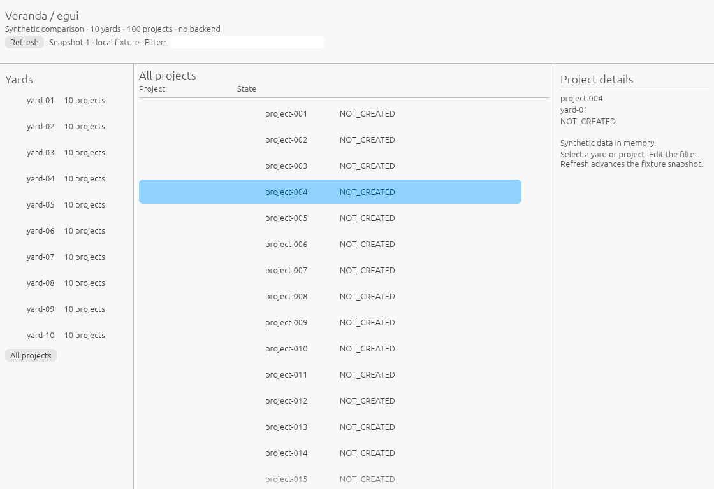
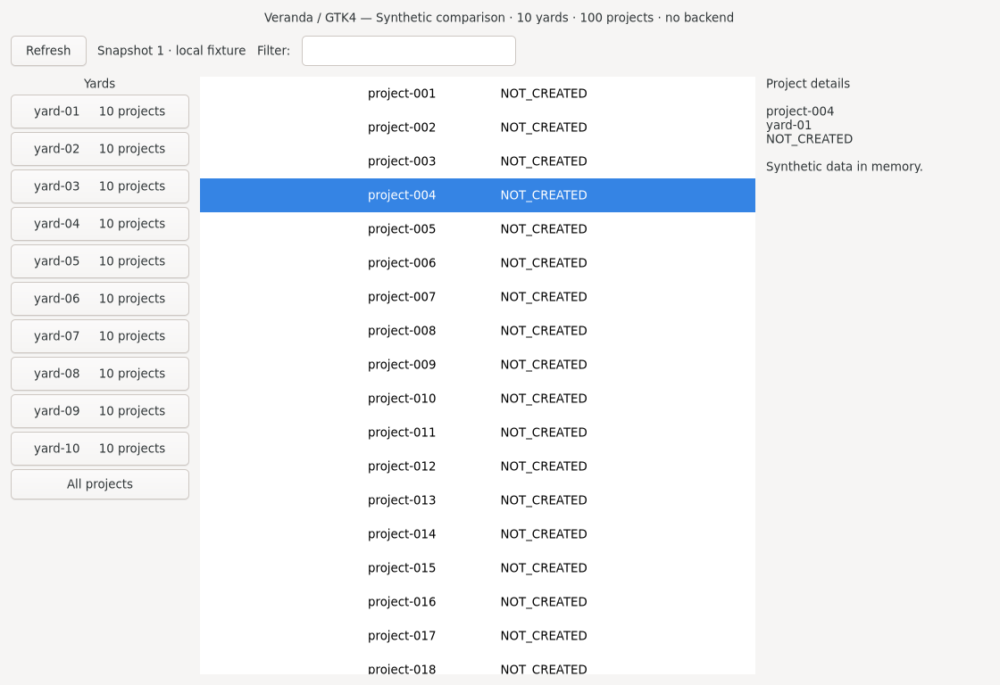

# Native framework comparison

**Decision (2026-10-11): Veranda uses GTK4 through gtk4-rs.** This reference preserves the
historical matched Qt Widgets, GTK4 and Slint results, plus a bounded egui follow-up,
their scope and maintenance tradeoffs.

In the historical comparison, Slint used the least measured memory; GTK used the least idle CPU and unpatched system libraries.
The measured GTK frontend was written in C with a Rust bridge, not gtk4-rs. These results guide
implementation but do not establish the final Rust GTK application's footprint. Full application,
platform and delivery acceptance remains outstanding.

## egui follow-up: synthetic UI only (2026-11-07)

A small, inspectable [standalone experiment](../../dev/experiments/veranda-gui-comparison/README.md)
compares **egui/eframe 0.37.0 with a matched GTK4 C control on the same VM**. Both show
10 synthetic yards and 100 project rows, with yard navigation, project selection, scrolling,
an editable name filter and explicit Refresh. Refresh advances a local snapshot counter;
there is no RPC, inventory scan, periodic polling or production action. These are UI-only
measurements, **separate from the historical real-backend desktop measurements below**.

| UI | State | RSS median, MiB | PSS median, MiB | CPU, one core |
| --- | --- | ---: | ---: | ---: |
| egui/eframe 0.37.0, Glow | visible | 135.52 | 116.26 | 0.008% |
| egui/eframe 0.37.0, Glow | minimized | 135.52 | 116.25 | 0.017% |
| GTK4 4.18.6 C, Cairo requested | visible | 120.75 | 95.27 | 0.000% |
| GTK4 4.18.6 C, Cairo requested | minimized | 120.75 | 95.26 | 0.000% |

Within each phase, memory median, nearest-rank p95 and observed maximum were identical.
Each phase had 120 valid samples over 120.34–120.37 seconds after 30 seconds of settling.
CPU uses the process's user+system tick delta. At 100 Hz, one tick over this window is about
0.0083% of one core: the GTK zero-tick results are below that accounting resolution, not
proof of zero work. Egui accumulated one visible and two minimized ticks; these tiny counts
do not establish a significant CPU ranking. Both implementations were quiet when idle.
GTK used less resident memory in this particular matched pair; this is not a general toolkit
minimum or an explanation of the different historical GTK result.

### Actual interfaces

These are unedited captures of the running applications after the same controls were exercised:
All projects, empty filter, project-004 selected and snapshot 1. Both client areas are 1120×768.
They are examples of the synthetic comparison, not the production Veranda design.

**egui/eframe:**



**GTK4 control:**



### How the layout code looks

Egui builds the layout inside `App::ui`; click handling stays beside the widget declaration.
Its immediate-mode API does not require continuous repainting: this example requests none.
The pinned [eframe API](https://docs.rs/eframe/0.37.0/eframe/trait.App.html) calls `ui` when
painting is needed. Trimmed from the [complete Rust source](../../dev/experiments/veranda-gui-comparison/src/main.rs):

```rust
egui::Panel::left("yards").exact_size(210.0).show(ui, |ui| {
    ui.heading("Yards");
    if ui.button("All projects").clicked() {
        self.yard = 0;
    }
});
egui::CentralPanel::default().show(ui, |ui| {
    ui.heading("All projects");
    egui::ScrollArea::vertical().show(ui, |ui| {
        // Project buttons update self.project when clicked.
    });
});
```

GTK constructs persistent widgets and connects selection callbacks. The corresponding shape
in the [complete C control](../../dev/experiments/veranda-gui-comparison/gtk-control.c) is:

```c
GtkWidget *body = gtk_box_new(GTK_ORIENTATION_HORIZONTAL, 12);
GtkWidget *yards = gtk_box_new(GTK_ORIENTATION_VERTICAL, 4);
GtkWidget *scroll = gtk_scrolled_window_new();
projects = gtk_list_box_new();
gtk_widget_set_hexpand(scroll, TRUE);
gtk_scrolled_window_set_child(GTK_SCROLLED_WINDOW(scroll), projects);
gtk_box_append(GTK_BOX(body), yards);
gtk_box_append(GTK_BOX(body), scroll);
g_signal_connect(projects, "row-selected", G_CALLBACK(select_project), NULL);
```

These excerpts show layout structure, not complete runnable programs; the linked sources contain
all controls. This comparison does not measure gtk4-rs or change Veranda's GTK decision.

### Environment, verification and reproduction

The disposable Debian 13 amd64 VM had four logical CPUs, a 4 GiB allocation and 20 GiB disk.
It used Xvfb `2:21.1.16-1.3+deb13u4`, Openbox `3.6.1-12+b2`, a 1920×1080×24 X11 display,
and no compositing manager. Both apps inherited `DISPLAY=:99`, `LIBGL_ALWAYS_SOFTWARE=1`,
`GDK_BACKEND=x11` and `GSK_RENDERER=cairo`. Egui's actual OpenGL context reported
**llvmpipe (LLVM 19.1.7, 256 bits)**, with Mesa `25.0.7-2+deb13u1`; eframe selected Glow.
GTK `4.18.6+ds-2` was requested to use Cairo; its internal renderer type was not instrumented.
These display/renderer settings differ from the historical Wayland experiment.

Rust/Cargo 1.99.1 built the release binary with pinned eframe and a checked-in lockfile.
The enabled eframe features are `accesskit`, `default_fonts`, `glow` and `x11`;
`wgpu`, `wayland` and `persistence` features are disabled. Dependencies are unpatched.
The C control used `cc -O2 -Wall -Wextra -Werror`. Formatting, locked release build,
real pointer/keyboard navigation, selection, scrolling, ASCII filter editing/restoration,
Refresh, useful screenshots and natural closure passed for the final binaries.

Runs were sequential and counted only each GUI process, including all its threads.
The probe refused child processes, checked stable PID/start time and verified X11 mapped/hidden
state before and after each phase. No process/PSS sample was missing. Xvfb, Openbox, session/
accessibility services, input tools and the sampler were excluded. Across the four windows,
guest CPU idle time was 99.915–99.925%, steal was 0.0021–0.0042%, and CPU PSI `some avg10`
was 0.00–0.00%. These guest observations cannot establish absence of external load on the physical host.
Both applications exited with status zero; export and lease release succeeded.

The [demo README](../../dev/experiments/veranda-gui-comparison/README.md) gives build/run/probe
commands and the source-binding calculation. The measured source manifest SHA-256 is
`430a7abf3fdc7ee109e63f8d56ca9c85e9831fa2d97558d3bd0aeb15337e4cf9`.
Binary SHA-256 identities are:

- egui: `ccc460af5c013bf7e503a174f4c63bc95dd5cb4d07018f7c9a2a26aeae547948`
- GTK: `346e4248b5a35479b079e57ef62d404755e11fa0e032e504f1fbd9c2d85f92e2`

Raw samples, logs and source/binary bindings were retained in the task's `.build` artifacts;
the table was recomputed from those samples. This single run does not qualify real-backend
cost, hardware GPU behavior, accessibility/IME, other platforms or full Veranda resource acceptance.

## Historical results (2026-10-10)

Measurements were taken on 2026-10-10. RSS and PSS are medians in MiB. Each candidate had
the same memory median, p95 and observed maximum in its visible and minimized windows.
CPU is the average percentage of one logical CPU for the entire desktop scope.

| Candidate | UI RSS | Desktop RSS | Desktop PSS | Visible CPU | Minimized CPU |
| --- | ---: | ---: | ---: | ---: | ---: |
| Slint 1.18.1, patched software renderer | 35.00 | 62.48 | 55.86 | 0.050% | 0.083% |
| Qt Widgets 6.8.2, system libraries | 51.91 | 86.93 | 76.03 | 0.050% | 0.108% |
| GTK4 4.18.6, system libraries, Cairo renderer | 41.98 | 76.72 | 62.11 | 0.008% | 0.017% |

Slint's desktop scope contained its UI and the local Go RPC process. Qt and GTK additionally
used the same native Rust bridge. All processes were counted once, including shared pages
in summed RSS. PSS was reported separately. The compositor, input/resource probes, fixture,
Incus and external workloads were outside this scope. No app-owned processes were unclassified.

Slint's local Go process used about 27.47 MiB RSS. At the final sample, its UI mappings
accounted for about 18.34 MiB of file-backed pages, 10.10 MiB of anonymous pages and
6.56 MiB of shared memory. File-backed pages include executable/library/font mappings;
anonymous pages are not an allocator-specific heap profile. This identifies broad resident
categories, without attributing individual allocations or claiming a memory effect from patches.

GTK had the lowest measured idle CPU. Qt's minimized average slightly exceeded the 0.1%
optimization target; all three stayed below the 0.5% limit. These are single bounded runs,
not statistical estimates across machines or proof of full application resource acceptance.

## Method and evidence scope

The workload was **10 yards and 100 projects in total**, with authoritative inventory/details,
all projects reported as `NOT_CREATED`, explicit Refresh and no periodic polling or event
generator. Each native UI displayed real responses from the same Rust/Go backend. Qt used a
C++ frontend and GTK a C frontend; Rust GTK/Relm4 integration costs were not measured.

The environment was Debian 13 amd64, 4 logical CPUs, 8 GiB RAM, a 40 GiB disposable VM,
labwc 0.8.3 with Pixman, no Xwayland, 1920×1080 at 60 Hz and scale 1, and an 1120×768
application window. Slint used its software Wayland renderer; Qt used its Wayland platform;
GTK used its Wayland/Cairo backend. The toolkit packages were Qt base
`6.8.2+dfsg-9+deb13u2`, Qt Wayland `6.8.2-4`, GTK `4.18.6+ds-2` and AT-SPI
`2.56.2-1+deb13u2`. Slint was built with Rust 1.92.0.

Before measurement, each exact build passed preparation, useful launch, real selection and
scrolling, Unicode input/restoration, physical Refresh, natural closure and cleanup. All seven
original checks passed, with four actual backend responses and three ordered physical pointer
acknowledgments. GUI, Go and bridge identities exited naturally, and the app cgroup and
top-level process set were empty before controlled cleanup. Fixture removal and lease release
passed. Actual useful-screen images and raw response/source bindings were reviewed.

Runs were sequential. The existing `dev/measure-veranda.py` helper measured each visible and
minimized state after 30 seconds of settling, for at least 120 seconds and 120 samples.
Process identities were stable; no process/PSS samples were missing; all windows were eligible
with no recorded pressure. App-cgroup event counters were zero. Root-cgroup event telemetry was
unavailable, so host-wide absence of pressure was not established. Memory statistics and
per-process sums were recomputed from retained raw samples.

The Slint/Qt source bundle was
`a18865f7b8c3a468935168c972eb7cda682b3f791319ffb4f60add817c22cee9`.
GTK used the corrected bundle
`dab6603a8c9788621913a9ec9012d2ee41a90469b07e52efbdcb98dff410dfca`.
Only the GTK accessibility read-error handling changed; backend, workload, environment,
method and native binaries remained identical. A failed GTK attempt stopped before resource
sampling. After a provider-node diagnostic and a successful new short check, only GTK was
remeasured. Unaffected Slint/Qt results were retained.

These bundles contain temporary prototype sources and six frozen native artifacts; they are
not a released package or a claim that the current repository HEAD builds those prototypes.
The retained source-bound evidence identifies the exact binaries and executed checks.

## Maintenance and next stage

The Slint result includes four local correctness forks: `accesskit_unix` 0.22.1,
`accesskit_atspi_common` 0.19.1, `i-slint-core` 1.18.1 and `i-slint-backend-winit` 1.18.1.
They change AT-SPI signal argument encoding, disabled accessibility states, aggregate keyboard
modifier handling across core/Winit, and complete repainting of scheduled software frames.
The pristine upstream sources were compared against the pinned sources. Stock Slint behavior
and footprint remain unqualified; no memory benefit from these patches has been established.
Any future reuse of that Slint prototype must account for maintaining, reducing or upstreaming
them and for dependency notices. They are not dependencies of the selected GTK implementation.
Qt/GTK system libraries were unpatched in this comparison.

The next stage is a public gtk4-rs shell with the full [UX contract](README.md), session/trust,
accessibility/IME and packaging coverage. The original [resource and reliability
requirements](../reference/control-plane-architecture.md#veranda-resource-budgets) remain:
ordinary 20-yard/200-project and stress 5-owner/100-yard/1000-project workloads, event bursts,
startup repetitions, 20 measured reconnects, peak memory and actual paint latency. A bounded
10-yard/100-project comparison does not satisfy those release gates. Windows/macOS and signed
delivery require their own checks. Tauri/WebKitGTK remains excluded; its [historical
measurements](webview-memory-reference.md) are retained only as reference.
